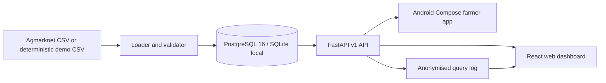

# Architecture

The backend is the single source of truth for pricing, distance, cost,
freshness, ranking, sell-or-wait guidance, seasonality, crop-profit insights,
and chat intent responses. Web and Android clients only format API responses;
they never recompute prices.

## Boundaries

- **Loader:** accepts documented CSV columns, validates records, marks demo
  records, and reports structure changes clearly.
- **Database:** stores crops, mandis, price reports, arrivals, crop
  assumptions, settings, users, and anonymised query logs.
- **API:** validates requests, applies domain services, and returns a common
  envelope containing `data_as_of` and `is_demo`.
- **Clients:** use the API contract, expose loading/empty/error/offline states,
  and display freshness and demo labels.

