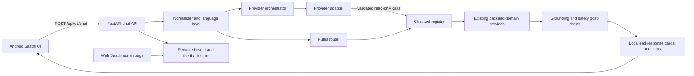

# FairFarm Saathi discovery and design

## Part 0 verification

The existing repository has the backend, web dashboard, and Android app
described by the feature prompt, but several capabilities are only starters:

| Prompt assumption | Verified repository state | Consequence |
|---|---|---|
| Existing chat service under a chat package | `backend/app/services/chat.py` is a single rules provider with generic answers | Saathi needs a package boundary, provider adapters, tools, grounding, and safety without breaking the existing route until the new contract lands |
| Existing chat API contract | `POST /api/v1/chat` accepts `message`, `language`, optional `crop_id`, and tuple location; its response is `intent`, localized answer, and chips | The feature contract is a breaking expansion; schemas, OpenAPI, tests, and clients must be migrated together |
| Existing pricing and recommendation services | `pricing.py`, `sell_wait.py`, and the in-memory `store.py` back current routes | Chat tools must call these backend services and never calculate prices in Android or an LLM |
| Trend, seasonality, and crop-profit services | Routes exist in `main.py`, but their current data is deterministic placeholder/demo output | Tools can expose them, but replies must preserve DEMO and freshness labels and avoid implying measured real-world data |
| Hilt, Room, and osmdroid are implemented | Room and osmdroid dependencies exist; no Hilt setup, Room database, or map flow was found | Android work must add the missing wiring incrementally; map and voice remain explicit feature tasks |
| Android has an Ask entry point | `MainActivity.kt` has a bottom navigation shell, but no chat screen or chat Retrofit methods | Add the Ask flow and API contract rather than assuming an existing screen |
| Admin chat analytics exist | The dashboard has generic summary/query pages and no Saathi page or chat metrics store | Analytics storage and the final admin page are later-scope work |

## Target architecture

The server owns context merging, coordinates, rate limits, tool arguments,
language output, grounding, and safety. The Android app sends user input and
displays typed response data; it never stores an LLM key or recomputes money.

## Planned read-only tools

| Tool | Backend source | Server-injected context |
|---|---|---|
| `find_best_mandis` | recommendation and pricing services | farmer location |
| `get_mandi_price` | mandi view and freshness service | none |
| `get_price_trend` | trend service | none |
| `get_sell_or_wait` | sell/wait service | none |
| `get_seasonality` | seasonality route/service | none |
| `get_crop_suggestions` | crop-profit route/service | none |
| `explain_term` | curated knowledge base | none |
| `app_help` | curated knowledge base | none |
| `get_data_status` | freshness and demo metadata | none |

Every tool will use Pydantic-validated arguments and return typed data with
freshness and demo provenance where applicable.

## Data flow and privacy

1. Normalize Unicode, units, numbers, and whitespace.
2. Detect language/script and extract crop, quantity, and intent.
3. Merge only server-owned context such as rounded location and the last
   recommendation.
4. Route clear requests through rules; use an optional provider only for
   configured, healthy, ambiguous requests.
5. Validate tool output, ground every numeric/entity claim, and fall back to a
   localized template on failure.
6. Redact phone numbers, Aadhaar-like identifiers, bank details, and secrets
   before logging. Keep sessions short-lived and limited to market context.

No user message trains a model. Provider keys remain backend-only environment
variables. Out-of-scope medical, legal, pesticide, fertilizer, loan, and
insurance requests receive a safe refusal.

## Decisions

- Preserve `/api/v1/chat` until the new request/response contract is implemented
  and covered by compatibility tests.
- Use `CHAT_MODE=auto|llm|rules`; rules mode must remain fully usable without an
  API key.
- Keep provider adapters behind one interface so tests use a deterministic fake.
- Treat current in-memory/demo services as the source for the first implementation
  while clearly returning `is_demo` and freshness metadata.
- Do not add a vector database; curated YAML plus keyword/fuzzy retrieval is
  sufficient for app help and term explanations.
